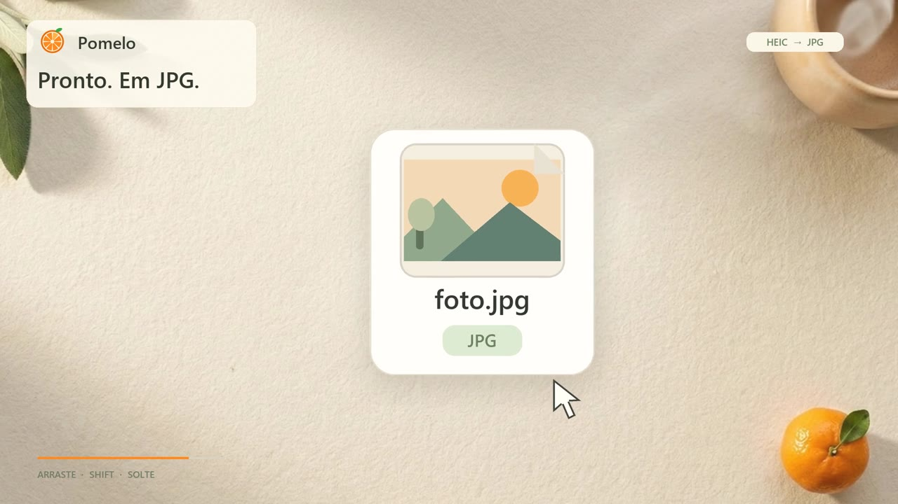
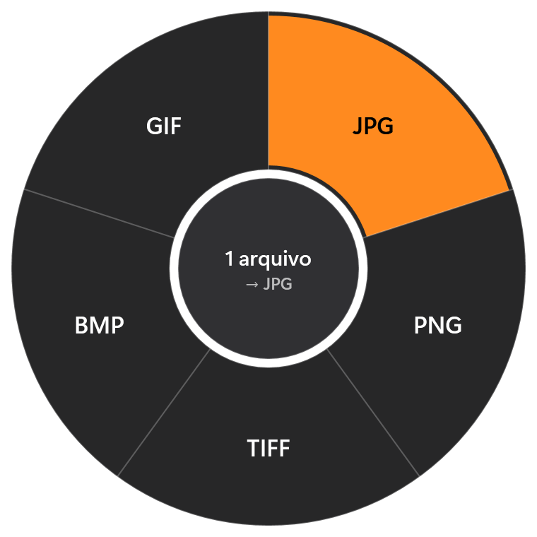
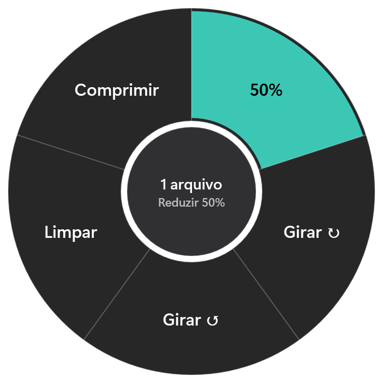
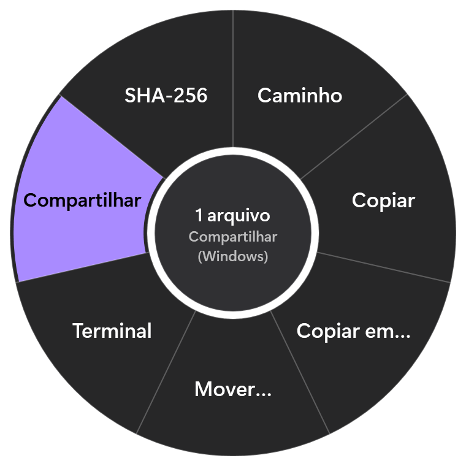
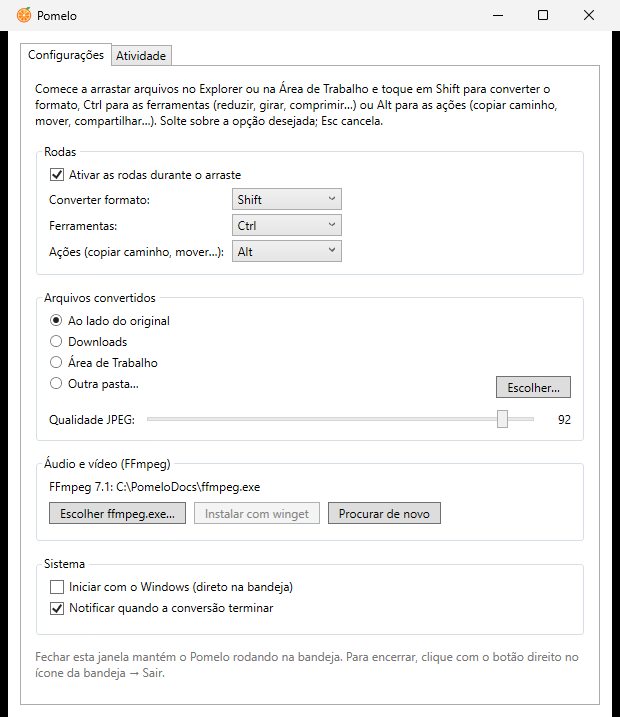
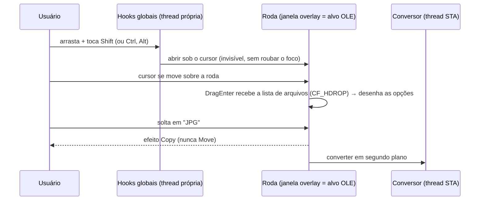

# Pomelo

Conversor de arquivos offline para Windows, sem cliques: comece a arrastar uma imagem, música ou vídeo no Explorer, toque **Shift** e solte sobre o formato desejado; **Ctrl** traz ferramentas como reduzir, girar e comprimir, e **Alt** traz ações como copiar o caminho, mover e compartilhar. Tudo roda localmente; nenhum arquivo sai do seu computador.

<p align="center">
  <a href="docs/media/pomelo-trailer.mp4"></a>
  <br>
  <sub>▶ <a href="docs/media/pomelo-trailer.mp4">Assista ao trailer (10 s, com som)</a></sub>
</p>

<table>
  <tr>
    <td align="center"></td>
    <td align="center"></td>
    <td align="center"></td>
  </tr>
  <tr>
    <td align="center"><b>Shift</b> · converter</td>
    <td align="center"><b>Ctrl</b> · ferramentas</td>
    <td align="center"><b>Alt</b> · ações</td>
  </tr>
</table>

Inspirado no [Tangerine](https://tangerineformac.com/), que existe só para Mac. Projeto independente, sem relação com o Tangerine.

> **Estado:** em desenvolvimento. Converte imagens, áudio, vídeo e PDF (páginas ↔ imagens) e edita os textos de PDFs; documentos do Office ainda não.

## Como usar

1. Abra o Pomelo. Ele fica na bandeja do sistema (perto do relógio; na primeira vez pode estar em "Mostrar ícones ocultos").
2. No Explorer ou na Área de Trabalho, **comece a arrastar** um ou mais arquivos (ou pastas, na roda de ações).
3. Com o botão do mouse ainda segurado, toque uma tecla (pode soltá-la em seguida). A roda abre sob o cursor:
   - **Shift**: roda de **conversão** (laranja), para mudar o formato.
   - **Ctrl**: roda de **ferramentas** (verde-água), para editar uma cópia.
   - **Alt**: roda de **ações** (lilás), para fazer algo com os próprios itens.

   Com a roda aberta, tocar outra dessas teclas troca de roda.
4. **Solte** os arquivos sobre a opção. Soltar no centro, ou apertar **Esc**, cancela.

Conversões, ferramentas e cópias preservam o original; apenas a ação **Mover…**, depois de escolher o destino, remove os itens da origem. Nenhum arquivo existente é substituído: se `foto.jpg` já existir, o resultado vira `foto (1).jpg`. Ao terminar, uma notificação mostra o resultado; clicar nela abre o Explorer com o item selecionado.

## Ferramentas

Cada ferramenta cria uma cópia com sufixo, por exemplo `foto - 50%.jpg`. Todos os arquivos soltos precisam ser do mesmo tipo (só imagens, só áudio ou só vídeo).

| Tipo | Ferramenta | O que faz | Resultado |
|---|---|---|---|
| Imagem | 50% | Reduz largura e altura pela metade | mesmo formato |
| Imagem | Girar ↻ / Girar ↺ | Gira 90° no sentido horário / anti-horário | mesmo formato |
| Imagem | Limpar | Remove EXIF, GPS e demais metadados | mesmo formato |
| Imagem | Comprimir | Lado maior até 2048 px, qualidade 70 | JPG |
| Áudio | Normalizar | Volume padronizado (EBU R128, −16 LUFS), 48 kHz | mesmo formato |
| Áudio | Mono | Mistura os canais em um | mesmo formato |
| Áudio | Comprimir | 128 kbps | MP3 |
| Áudio | Limpar | Remove tags e capa, sem recodificar | mesmo formato |
| Vídeo | Comprimir | H.264 (CRF 28) + AAC 128k; lado menor até 1080 px | MP4 |
| Vídeo | Girar ↻ | Gira 90° no sentido horário | MP4 |
| Vídeo | Sem áudio | Remove o áudio, sem recodificar o vídeo | mesmo formato |
| Vídeo | Limpar | Remove metadados e capítulos, sem recodificar | mesmo formato |

"Mesmo formato" de imagem vale para JPG, PNG, TIFF, BMP e GIF; WebP e ICO viram PNG, e HEIC/AVIF viram JPG, porque o Windows não grava esses formatos. Ferramentas de imagem recodificam, então JPGs passam pela qualidade configurada (exceto Comprimir, que usa 70). Ferramentas de áudio e vídeo precisam do FFmpeg.

### Editar textos de PDF

Arraste **um** PDF, toque **Ctrl** e solte em **Editar textos**. Abre uma janela com a página à esquerda e todas as linhas de texto à direita:

- Edite direto na lista, ou clique num texto da página para ir até ele. **Enter** aplica; a prévia mostra o resultado na hora, e **Desfazer** volta ao original daquela linha. Apagar todo o texto de uma linha remove a linha.
- **Buscar** filtra a lista; **Localizar e substituir** troca um texto em todas as linhas de uma vez (sem atravessar de uma linha para a outra).
- **Salvar cópia** cria `nome (editado).pdf`; o original não muda. Antes de entregar, o Pomelo reabre o arquivo gravado e confere cada alteração; se algo não bater, nada é criado.

A linha alterada mantém fonte, tamanho, cor e posição, e o texto antigo sai do arquivo (não fica escondido embaixo). Limites, os mesmos de editores como o Acrobat:

- **O texto não se reorganiza.** O PDF guarda linhas posicionadas, não parágrafos: um texto mais longo não empurra o resto. A lista avisa quando ele passa do espaço da linha e pode ficar por cima do que vem ao lado. Serve para corrigir nomes, datas, valores e frases curtas.
- **Letras que o PDF não tem.** Muitos PDFs guardam só as letras usadas. Se a alteração precisar de outra (um "Z" que não aparecia no documento, por exemplo), a linha é reescrita na mesma fonte instalada no Windows (ou em Arial), com aviso. Como a fonte inteira entra no arquivo, ele cresce algumas centenas de KB.
- **Recusados, com mensagem:** PDFs com senha ou proteção contra alterações, assinados digitalmente (a edição invalidaria a assinatura), escaneados ou só com imagens (não há texto), e os que usam fontes desenhadas (Type 3), que não dá para regravar sem estragar a página. Texto dentro de elementos agrupados (form XObjects) não aparece na lista.

A edição usa o [PDFium](https://pdfium.googlesource.com/pdfium/), o motor de PDF do Chrome (licença BSD), na compilação de [pdfium-binaries](https://github.com/bblanchon/pdfium-binaries) (Apache-2.0), que vem junto com o Pomelo.

## Ações

Funcionam com qualquer item: pastas, tipos misturados e arquivos sem conversão possível.

| Ação | O que faz |
|---|---|
| Caminho | Copia o caminho completo (um por linha) para a área de transferência |
| Copiar | Coloca os itens na área de transferência; Ctrl+V cola uma cópia no Explorer ou em outro app |
| Copiar em… | Copia para uma pasta escolhida na hora |
| Mover… | Move para uma pasta escolhida na hora; entre discos, copia e depois apaga a origem |
| Terminal | Abre o Windows Terminal (ou o PowerShell) na pasta |
| Compartilhar | Abre o painel Compartilhar do Windows (Compartilhamento por Proximidade, WhatsApp, e-mail…); só arquivos |
| SHA-256 | Copia o hash; para vários arquivos, no formato do `sha256sum`; só arquivos |
| Flutuar | Guarda os itens numa prateleira flutuante, para arrastá-los depois (veja abaixo) |

"Copiar em…" e "Mover…" lembram a última pasta usada, nunca substituem nada (um nome já usado vira `nome (1)`) e não colocam uma pasta dentro dela mesma, inclusive por junções ou aliases de disco.

- Cópias são montadas como `~pomelo-….part` e só recebem o nome final quando completas. Ao sair, o app cancela a cópia e aguarda sua limpeza por até 5 segundos; um encerramento forçado pode deixar um `.part`, mas não uma cópia incompleta com aparência de concluída.
- Mover a raiz de um disco é recusado. Entre discos, a origem só é removida depois da cópia completa; se não for possível apagá-la, o destino é mantido e aparece um **aviso**, com o caminho da cópia.
- Junções e links de pastas dentro de uma cópia são ignorados com aviso. Mover uma árvore com esses links entre discos é recusado; use o Explorer nesse caso.

### Prateleira (Flutuar)

Útil para juntar arquivos de pastas diferentes ou levar algo para uma janela que está escondida.

- **Flutuar** na roda de ações abre uma pequena prateleira no canto da tela com os itens arrastados. Solte mais arquivos sobre ela para acrescentar.
- Arraste **tudo** pelo cartão "Arraste daqui", ou **um item** pela própria linha, para qualquer pasta ou app. Durante esse arraste, Shift, Ctrl e Alt abrem as rodas normalmente.
- A prateleira guarda só o caminho: nada é copiado ao guardar, e ao arrastar para fora ela oferece somente **cópia**, então o original nunca sai do lugar.
- Itens movidos ou apagados aparecem como "não encontrado" e ficam de fora do arraste. O ✕ de uma linha tira o item da prateleira sem apagar o arquivo; o ✕ do topo esvazia e fecha.
- A prateleira fica por cima das janelas sem roubar o foco e pode ser movida pelo título. A lista não é salva ao sair do Pomelo.

## Formatos

### Imagens

| | Formatos |
|---|---|
| **Saída** | JPG, PNG, TIFF, BMP, GIF, PDF (todas as imagens arrastadas num só arquivo) |
| **Entrada** | JPG, PNG, TIFF, BMP, GIF, ICO, JPEG XR |
| **Entrada, com extensão da Microsoft Store** | WebP, HEIC/HEIF, AVIF |

- Fotos de celular são giradas conforme a orientação EXIF, então não saem deitadas.
- Em JPG, BMP e GIF (sem transparência), áreas transparentes viram fundo branco. GIF usa uma paleta otimizada de 256 cores.
- Perfis RGB são preservados em JPG, PNG e TIFF. Imagens CMYK/cinza com perfil, e saídas BMP/GIF, são convertidas para sRGB; o perfil de origem não é anexado a pixels de outro espaço de cor.
- GIF animado vira vídeo pela roda de conversão (veja abaixo). As ferramentas de imagem e TIFF com várias páginas ainda não aceitam arquivos com vários quadros: o Pomelo recusa com uma mensagem, em vez de descartar quadros em silêncio.

### PDF (sem instalar nada)

| | Formatos |
|---|---|
| **Imagens → PDF** | Todas as imagens arrastadas viram **um** PDF, uma por página |
| **PDF → imagens** | JPG ou PNG, uma imagem por página |

- **Imagens → PDF:** as páginas seguem a ordem do arraste e o arquivo leva o nome da primeira imagem (`foto.pdf`). Toda página é **A4**, deitada para imagens largas e em pé para as demais. A imagem fica centralizada, com margem de 1 cm: imagens grandes são reduzidas para caber, e as pequenas mantêm o tamanho natural (pela resolução, ou 96 DPI quando o arquivo não informa), sem serem ampliadas nem borradas. Nada é cortado nem esticado, e a resolução original é mantida para zoom e impressão. Fotos são guardadas em JPEG (com a qualidade das configurações); prints, desenhos e PNGs, sem perda. Transparência vira fundo branco. Se uma das imagens não puder ser lida, nenhum PDF é criado e a mensagem diz qual arquivo falhou.
- **PDF → imagens:** usa o leitor de PDF do próprio Windows, a 200 DPI, com fundo branco. Um PDF de uma página vira `doc.png`; com várias páginas, vira a pasta `doc` com `página 01.png`, `página 02.png`… A pasta só aparece com esse nome depois que todas as páginas foram geradas. PDFs protegidos por senha são recusados com uma mensagem.

### Áudio e vídeo (requer FFmpeg)

| | Formatos |
|---|---|
| **Áudio → áudio** | MP3, M4A (AAC), WAV, FLAC, OGG (Vorbis), OPUS, AIFF, WMA |
| **Vídeo → vídeo** | MP4 e MOV (H.264 + AAC), MKV, WEBM (VP9 + Opus), AVI, WMV, GIF animado |
| **Vídeo → áudio** | MP3 (extrai a trilha sonora) |
| **GIF animado → vídeo** | MP4, MOV, MKV, WEBM, AVI, WMV |
| **Entrada de áudio** | MP3, M4A, AAC, WAV, FLAC, OGG, OPUS, AIFF, WMA |
| **Entrada de vídeo** | MP4, M4V, MOV, MKV, WEBM, AVI, WMV, FLV, MPG, TS/MTS/M2TS, 3GP, OGV, GIF animado |

- Usa o primeiro fluxo de vídeo e o primeiro de áudio; legendas e capas embutidas não são copiadas.
- Vídeos com largura ou altura ímpar são ajustados em 1 pixel (exigência do H.264). GIF animado sai com 12 fps e no máximo 640 px de largura.
- GIF animado vira vídeo sem som, com os mesmos quadros e tempos do original; áreas transparentes viram fundo branco. Um GIF de um só quadro continua sendo tratado como imagem.
- WMA e WMV saem com áudio estéreo, inclusive quando a entrada tem som surround (5.1 ou mais canais).
- Só aparecem os formatos que o FFmpeg instalado consegue gerar.
- O FFmpeg roda com prioridade baixa, para não travar o computador. Durante a conversão, passe o mouse no ícone da bandeja para ver o andamento. Enquanto converte, existe um arquivo temporário `~pomelo-….part` na pasta de saída, apagado em caso de falha ou ao sair do Pomelo.

A roda só oferece formatos que servem para **todos** os arquivos arrastados. Por exemplo, um WAV e um MP4 juntos só podem virar MP3.

### FFmpeg

O Pomelo não embute o FFmpeg nem baixa nada sozinho. Ele procura, nesta ordem: o caminho escolhido nas configurações, uma pasta `ffmpeg\` ao lado do `Pomelo.exe`, o `PATH`, e as instalações do winget, Scoop e Chocolatey. Sem FFmpeg, a roda mostra "Requer FFmpeg" para áudio e vídeo.

Para instalar, use **Instalar com winget** na janela do Pomelo, ou rode:

```sh
winget install --id Gyan.FFmpeg.Essentials --exact
```

## Configurações

Clique no ícone da bandeja para abrir a janela:

<p align="center"></p>

- **Rodas:** ligar/desligar, e a tecla de cada roda: conversão, ferramentas e ações (Shift, Ctrl ou Alt; escolher a tecla de outra roda troca as duas).
- **Arquivos convertidos:** ao lado do original, em Downloads, na Área de Trabalho ou numa pasta escolhida. Qualidade do JPEG.
- **Áudio e vídeo:** qual FFmpeg está em uso, escolher outro `ffmpeg.exe`, instalar com winget ou procurar de novo.
- **Sistema:** iniciar com o Windows (abre direto na bandeja) e notificações ao concluir.

As configurações ficam em `%APPDATA%\Pomelo\settings.json`. Iniciar com o Windows usa a chave `HKCU\Software\Microsoft\Windows\CurrentVersion\Run`, sem precisar de administrador. Se você desativar o Pomelo em Gerenciador de Tarefas → Aplicativos de inicialização, a janela mostra a opção desmarcada.

Fechar a janela mantém o Pomelo na bandeja. Para encerrar: clique com o botão direito no ícone → **Sair**. Abrir o Pomelo de novo enquanto ele roda só traz a janela existente.

## Compilar e rodar

Requisitos: Windows 10 versão 2004 ou mais recente, ou Windows 11 (x64), e o [SDK do .NET 10](https://dotnet.microsoft.com/download/dotnet/10.0).

```sh
git clone https://github.com/KauaBR0/pomelo.git
cd pomelo
dotnet run --project src/Pomelo
```

Para iniciar já na bandeja, sem a janela: `dotnet run --project src/Pomelo -- --background`.

Testes:

```sh
dotnet test
```

Os testes de áudio e vídeo rodam o FFmpeg de verdade e são pulados se ele ou os codificadores exigidos pelo teste não estiverem disponíveis.

### Desinstalar

Desmarque "Iniciar com o Windows" (ou apague o valor `Pomelo` na chave `Run`), saia pela bandeja e apague a pasta `%APPDATA%\Pomelo`.

## Como funciona

O macOS tem uma área de transferência global do arraste, então um app consegue saber o que está sendo arrastado em qualquer lugar. O Windows não tem. O Pomelo resolve assim:



- **Detecção do gesto** (`src/Pomelo/Input/GestureMonitor.cs`): hooks de mouse e teclado de baixo nível numa thread dedicada. Só observam, nunca consomem ou registram teclas.
- **Roda** (`src/Pomelo/Wheel/`): janela sempre no topo, que não ativa, registrada como alvo de soltura. Ela abre invisível e só aparece se um arraste de *arquivos* entrar nela. Arrastes de texto ou links passam direto.
- **A soltura nunca move o original:** no Explorer, Shift durante o arraste significa "mover". A roda sempre responde "copiar" ao Explorer; mover só acontece pela ação **Mover…**, depois de você escolher a pasta.
- **Conversão e ferramentas** (`src/Pomelo.Core/Conversion/`, `src/Pomelo.Core/Tools/`): imagens pelo Windows Imaging Component (WIC, via WPF), sem dependências externas; PDF ↔ imagens pelo leitor de PDF do Windows (`Windows.Data.Pdf`) e por um gravador próprio; áudio e vídeo por um processo FFmpeg (`src/Pomelo.Core/Media/`). Cada arquivo de um lote falha ou passa de forma independente.
- **Editar textos de PDF** (`src/Pomelo.Core/Documents/PdfTextDocument.cs`, `src/Pomelo/PdfEditor/`): o PDFium lista os objetos de texto de cada página; o Pomelo junta os pedaços (muitos PDFs gravam palavra por palavra ou letra por letra) em linhas pela linha de base, fonte, tamanho e cor. Cada edição é refeita a partir do original, então desfazer é exato. Letras ausentes são detectadas relendo o texto depois da troca.
- **Ações** (`src/Pomelo/Actions/`, `src/Pomelo.Core/Actions/`): o painel Compartilhar usa a API do Windows para apps desktop (`DataTransferManager`); o "Compartilhar" do menu de contexto do Explorer só funciona dentro do próprio Explorer. Como quem está em primeiro plano na hora da soltura é o Explorer, os diálogos são trazidos para a frente explicitamente.

### Estrutura

```
src/Pomelo/          app WPF: bandeja, roda, hooks, janela de configurações
src/Pomelo.Core/     formatos, conversor, configurações, inicialização com o Windows
tests/Pomelo.Tests/  testes do núcleo (xUnit)
```

## Próximos passos

- Editores com ajuste fino (recortar, escolher tamanho/qualidade, cortar áudio e vídeo)
- Instalador

## Licença

[MIT](LICENSE)
