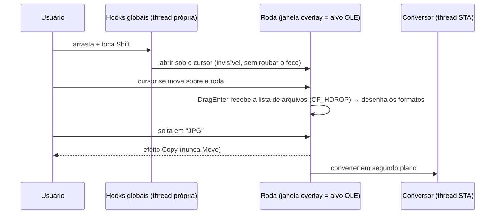

# Pomelo

Conversor de arquivos offline para Windows, sem cliques: comece a arrastar uma imagem no Explorer, toque **Shift** e solte sobre o formato desejado. A cópia convertida aparece ao lado do original. Tudo roda localmente; nenhum arquivo sai do seu computador.

Inspirado no [Tangerine](https://tangerineformac.com/), que existe só para Mac. Projeto independente, sem relação com o Tangerine.

> **Estado:** em desenvolvimento. Hoje converte imagens; áudio, vídeo, PDF e documentos ainda não.

## Como usar

1. Abra o Pomelo. Ele fica na bandeja do sistema (perto do relógio; na primeira vez pode estar em "Mostrar ícones ocultos").
2. No Explorer ou na Área de Trabalho, **comece a arrastar** um ou mais arquivos de imagem.
3. Com o botão do mouse ainda segurado, **toque Shift** (pode soltar a tecla). A roda abre sob o cursor.
4. **Solte** os arquivos sobre o formato. Soltar no centro, ou apertar **Esc**, cancela.

O original nunca é alterado nem movido, e nenhum arquivo existente é substituído: se `foto.jpg` já existir, o resultado vira `foto (1).jpg`. Ao terminar, uma notificação mostra o resultado; clicar nela abre o Explorer com o arquivo selecionado.

## Formatos

| | Formatos |
|---|---|
| **Saída** | JPG, PNG, TIFF, BMP, GIF |
| **Entrada** | JPG, PNG, TIFF, BMP, GIF, ICO, JPEG XR |
| **Entrada, com extensão da Microsoft Store** | WebP, HEIC/HEIF, AVIF |

- Fotos de celular são giradas conforme a orientação EXIF, então não saem deitadas.
- Em JPG, BMP e GIF (sem transparência), áreas transparentes viram fundo branco. GIF usa uma paleta otimizada de 256 cores.
- O perfil de cor é preservado em JPG, PNG e TIFF; em BMP e GIF, a imagem é convertida para sRGB.
- GIF animado e TIFF com várias páginas ainda não são suportados: o Pomelo recusa com uma mensagem, em vez de descartar quadros em silêncio.
- A roda só oferece conversões quando **todos** os arquivos arrastados são imagens.

## Configurações

Clique no ícone da bandeja para abrir a janela:

- **Roda:** ligar/desligar, e a tecla que a abre durante o arraste (Shift, Ctrl ou Alt).
- **Arquivos convertidos:** ao lado do original, em Downloads, na Área de Trabalho ou numa pasta escolhida. Qualidade do JPEG.
- **Sistema:** iniciar com o Windows (abre direto na bandeja) e notificações ao concluir.

As configurações ficam em `%APPDATA%\Pomelo\settings.json`. Iniciar com o Windows usa a chave `HKCU\Software\Microsoft\Windows\CurrentVersion\Run`, sem precisar de administrador. Se você desativar o Pomelo em Gerenciador de Tarefas → Aplicativos de inicialização, a janela mostra a opção desmarcada.

Fechar a janela mantém o Pomelo na bandeja. Para encerrar: clique com o botão direito no ícone → **Sair**. Abrir o Pomelo de novo enquanto ele roda só traz a janela existente.

## Compilar e rodar

Requisitos: Windows 10 ou 11 (x64) e o [SDK do .NET 10](https://dotnet.microsoft.com/download/dotnet/10.0).

```sh
git clone https://github.com/KauaBR0/pomelo.git
cd pomelo
dotnet run --project src/Pomelo
```

Para iniciar já na bandeja, sem a janela: `dotnet run --project src/Pomelo -- --background`.

Testes:

```sh
dotnet test
```

### Desinstalar

Desmarque "Iniciar com o Windows" (ou apague o valor `Pomelo` na chave `Run`), saia pela bandeja e apague a pasta `%APPDATA%\Pomelo`.

## Como funciona

O macOS tem uma área de transferência global do arraste, então um app consegue saber o que está sendo arrastado em qualquer lugar. O Windows não tem. O Pomelo resolve assim:



- **Detecção do gesto** (`src/Pomelo/Input/GestureMonitor.cs`): hooks de mouse e teclado de baixo nível numa thread dedicada. Só observam, nunca consomem ou registram teclas.
- **Roda** (`src/Pomelo/Wheel/`): janela sempre no topo, que não ativa, registrada como alvo de soltura. Ela abre invisível e só aparece se um arraste de *arquivos* entrar nela. Arrastes de texto ou links passam direto.
- **Nunca move o original:** no Explorer, Shift durante o arraste significa "mover". A roda sempre responde "copiar".
- **Conversão** (`src/Pomelo.Core/`): Windows Imaging Component (WIC, via WPF), sem dependências externas. Cada arquivo de um lote falha ou passa de forma independente.

### Estrutura

```
src/Pomelo/          app WPF: bandeja, roda, hooks, janela de configurações
src/Pomelo.Core/     formatos, conversor, configurações, inicialização com o Windows
tests/Pomelo.Tests/  testes do núcleo (xUnit)
```

## Próximos passos

- Áudio e vídeo via FFmpeg
- Roda de ferramentas (comprimir, redimensionar, girar…) e roda de ações de arquivo
- PDF e documentos
- Instalador

## Licença

[MIT](LICENSE)
